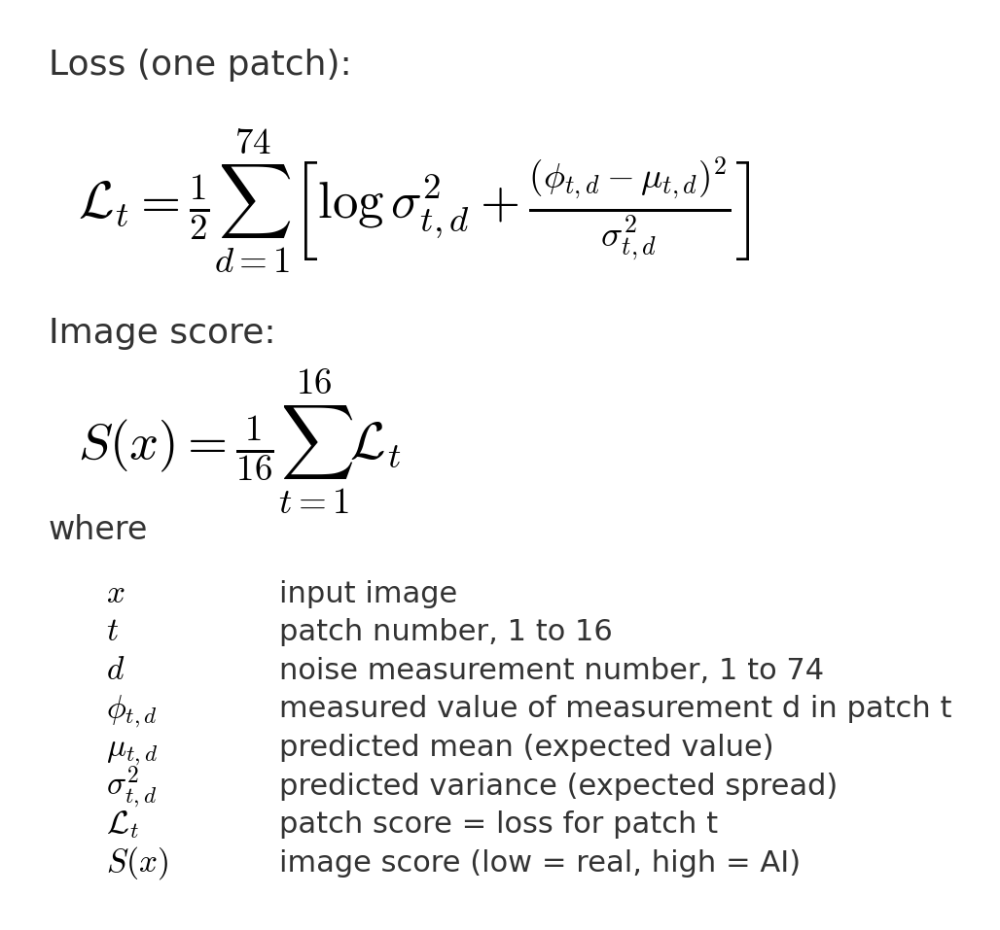

# Auth-JEPA

Detecting AI-generated images by predicting camera physics, trained on real photographs only.

| Folder | What it shows |
|---|---|
| `01_patches` | 512 x 512 window, never resized, cut into 16 patches of 128 x 128 |
| `02_denoiser` | wavelet-domain Wiener filter: smoothed patch and removed noise |
| `03_inputs` | the 15 inputs: 13 picture measurements and 2 JPEG values |
| `04_noise_measurements` | the 74 noise measurements (45 original + 29 added) |
| `05_predictor` | the predictor network |
| `06_training_and_score` | Gaussian loss, training, patch score and image score |
| `07_test_conditions` | raw and JPEG-90 test images |
| `08_auroc` | AUROC per generator, then averaged |
| `09_two_models_threshold` | two models, calibration and the fixed cut-off |
| `dataset` | file lists and example images for every dataset and generator |
| `output` | result tables and output images, by slide |

## Loss function and score

Auth-JEPA is trained with the **Gaussian negative log-likelihood (NLL)**. For every patch *t*, the predictor gives a mean μ and a variance σ² for each of the 74 noise measurements *d*. The loss compares them with the measured value φ.



```
Loss (one patch):  L_t  = 1/2 × Σ over d = 1..74 of [ log σ²(t,d) + (φ(t,d) − μ(t,d))² / σ²(t,d) ]
Image score:       S(x) = 1/16 × Σ over t = 1..16 of L_t
```

where

| Symbol | Meaning |
|---|---|
| x | input image |
| t | patch number, 1 to 16 |
| d | noise measurement number, 1 to 74 |
| φ(t,d) | measured value of measurement d in patch t |
| μ(t,d) | predicted mean (expected value) |
| σ²(t,d) | predicted variance (expected spread) |
| L_t | patch score = loss for patch t |
| S(x) | image score (low = real, high = AI) |
| Σ | sum |
| log | natural logarithm |

- **log σ²** stops the network from predicting a large spread everywhere.
- **(φ − μ)² / σ²** penalises a wrong prediction, scaled by the expected spread.
- **Training** minimises the mean of L_t over all patches of the real training photos. No AI-generated image is used.
- **Image score** is the same quantity averaged over the 16 patches of a 512 × 512 window. Low = noise looks like a real camera's; high = flagged as AI-generated.

Both are implemented by `tile_nll` in `06_training_and_score/loss_and_score.py`.
